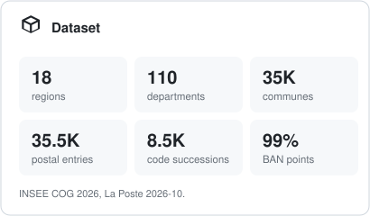
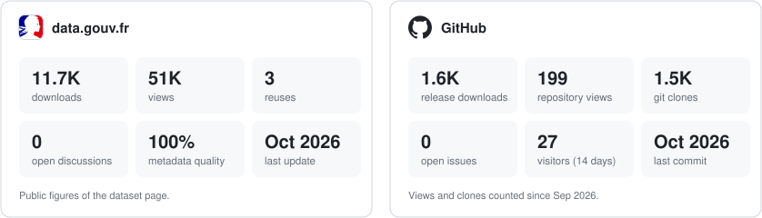
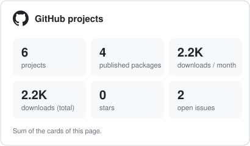
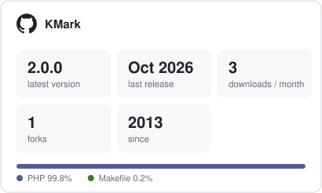
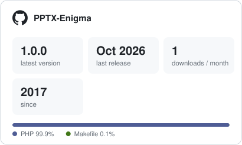
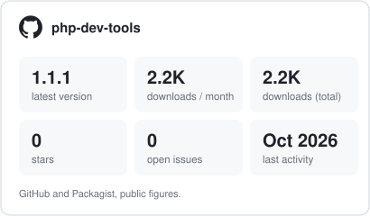
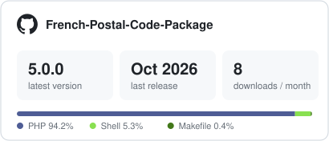
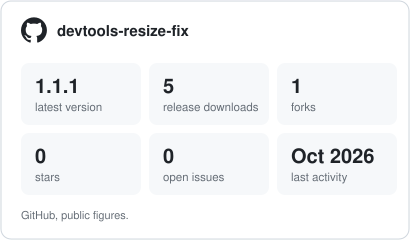
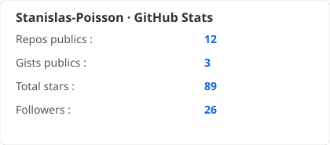
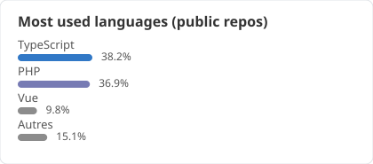

# Hi, I'm Stanislas 👋

![Experience][badge-experience] ![Availability][badge-available]

Senior Fullstack Developer specialized in Laravel, Vue.js and Docker. I take over legacy web platforms that nobody documented, make them faster and safer to change, and set up the CI and quality tooling a team needs to keep them that way.

🟢 **Open to opportunities**: permanent, fixed-term or freelance roles, remote preferred, hybrid or on-site possible. Available immediately. Based in Tours (37), with accommodation available in Paris and Normandy.

## Results

| HTTP response time | Database migration | Production stability | Team productivity |
|:---:|:---:|:---:|:---:|
| **750 → 160 ms** (÷4.7) | **200,000+ entries in 11 h** | **0 incidents over 18 months** | **about +35 %** (announced) |
| Hey Pongo | Majordome Santé | Majordome Santé | SETIPP |

## What I focus on

- Taking over legacy code without documentation, in autonomy
- Performance optimization and database migration
- Industrialized environments: Docker, CI/CD, code quality tooling
- Technical mentoring: GitFlow, standards, onboarding

## Tech stack

![PHP][badge-php] ![Laravel][badge-laravel] ![Symfony][badge-symfony] ![MySQL][badge-mysql] ![Redis][badge-redis] ![GraphQL][badge-graphql]

![Vue.js][badge-vue] ![TypeScript][badge-ts] ![JavaScript][badge-js] ![Vite][badge-vite] ![Tailwind CSS][badge-tailwind]

![Docker][badge-docker] ![GitLab CI][badge-gitlab-ci] ![GitHub Actions][badge-gha] ![PHPStan][badge-phpstan] ![PHPUnit][badge-phpunit]

## Experience

| Period | Role | What I did |
|---|---|---|
| 03/2026 - 09/2026 | Senior Fullstack Developer · **Pix'Celle** (StimData) | Took over an undocumented in-house PHP framework on my own. 111 tickets in 6 months: 32 enhancements, 59 bug fixes, 10 specifications. |
| 07/2025 - 11/2025 | Fullstack Developer · **Paris Fashion Shops** | Backend of the supplier-space API of a B2B fashion marketplace (1,000+ suppliers, 100,000 references). 95 tickets in 4 months, Mangopay KYC, catalog performance. |
| 01/2024 - 06/2024 | Front-end Developer · **Weezioo** | Front-office of a transport management system, GraphQL learned on the job. |
| 06/2023 - 08/2023 | Fullstack Developer · **MEVIA DIGITAL** | Joined the team and took over the AlumnForce platform (PHP, Laravel). |
| 03/2023 - 06/2023 | Backend Developer · **Pongo** (Hey Pongo) | SQL optimization and application cache: HTTP response time from 750 ms to 160 ms (-79 %). |
| 02/2022 - 03/2023 | Senior Fullstack Developer · **SETIPP** | Laravel and Vue.js on SuiviDeFlotte.net and Beepiz. GitFlow and technical mentoring (about +35 % productivity, announced). |
| 05/2021 - 02/2022 | Fullstack Developer · **AC Web Agency** | Designed an e-commerce platform, PrestaShop migration (15,000+ entries) in 1 h, supervised 2 contractors. 83 tickets. |
| 09/2017 - 06/2021 | Senior Fullstack Developer · **Majordome Santé** (Team Officine) | Sole in-house developer of a pharmacist recruitment platform. Database redesigned (200,000+ entries) and migrated in 11 h, GitLab CI, 0 incidents over 18 months. 598 tickets. |
| 06/2017 - 09/2017 | Fullstack Developer · **FoxNot** | Symfony 3.3 project in difficulty, Scrum team of about ten people. 26 tickets in 3 months. |
| 08/2015 - 05/2017 | Fullstack Developer · **My-Serious-Game** | Sole developer of serious games for Bouygues, Vinci Autoroutes and Total. |

The full resume is on [stanislas-poisson.fr][website] ([PDF][cv-pdf]).

## Open source

Since 2024 I build an open source ecosystem in the open, with live coding on [Twitch][twitch] (400+ followers, 2,000+ hours streamed, close to 930 hours of code): Laravel and TypeScript packages, production Docker images and shared quality tooling, documented on GitLab Pages. The cards below refresh themselves every week.

### French Postal Code

Open dataset of the regions, departments, communes and postal codes of France, with one GPS point per postal code and the history of the changes, built from INSEE, La Poste and the Base Adresse Nationale. 87 stars, listed on data.gouv.fr, with a [Composer package][packagist-fpc] for Laravel and Symfony.

  
  

### On GitHub

  

  
  
  
  
  

### On GitLab

  

Laravel packages (Packagist)

  
  
  
  
  
  
  

TypeScript packages (npm)

  
  
  
  
  
  

## GitHub stats

  
  

## GitLab stats

  
  

## Find me

[![Website][pill-website]][website] [![LinkedIn][pill-linkedin]][linkedin] [![GitLab][pill-gitlab]][gitlab] [![Twitch][pill-twitch]][twitch] [![Email][pill-email]][email]

<!-- Links -->
[packagist-fpc]: https://packagist.org/packages/stanislas-poisson/french-postal-code
[gitlab]: https://gitlab.com/zairakai
[twitch]: https://twitch.tv/zairakai
[website]: https://stanislas-poisson.fr
[cv-pdf]: https://stanislas-poisson.fr/assets/docs/Senior_Fullstack_Engineer.pdf
[linkedin]: https://www.linkedin.com/in/stanislasp/
[email]: mailto:contact@stanislas-poisson.fr

<!-- Badges - Profile -->
[badge-experience]: https://img.shields.io/badge/Experience-10%2B_years-blue
[badge-available]: https://img.shields.io/badge/Available-immediately-2ea44f

<!-- Badges - Stack -->
[badge-php]: https://img.shields.io/badge/PHP-777BB4?style=flat&logo=php&logoColor=white
[badge-laravel]: https://img.shields.io/badge/Laravel-FF2D20?style=flat&logo=laravel&logoColor=white
[badge-symfony]: https://img.shields.io/badge/Symfony-000000?style=flat&logo=symfony&logoColor=white
[badge-mysql]: https://img.shields.io/badge/MySQL-4479A1?style=flat&logo=mysql&logoColor=white
[badge-redis]: https://img.shields.io/badge/Redis-DC382D?style=flat&logo=redis&logoColor=white
[badge-graphql]: https://img.shields.io/badge/GraphQL-E10098?style=flat&logo=graphql&logoColor=white
[badge-vue]: https://img.shields.io/badge/Vue.js-4FC08D?style=flat&logo=vuedotjs&logoColor=white
[badge-ts]: https://img.shields.io/badge/TypeScript-3178C6?style=flat&logo=typescript&logoColor=white
[badge-js]: https://img.shields.io/badge/JavaScript-F7DF1E?style=flat&logo=javascript&logoColor=black
[badge-vite]: https://img.shields.io/badge/Vite-646CFF?style=flat&logo=vite&logoColor=white
[badge-tailwind]: https://img.shields.io/badge/Tailwind_CSS-06B6D4?style=flat&logo=tailwindcss&logoColor=white
[badge-docker]: https://img.shields.io/badge/Docker-2496ED?style=flat&logo=docker&logoColor=white
[badge-gitlab-ci]: https://img.shields.io/badge/GitLab_CI-FC6D26?style=flat&logo=gitlab&logoColor=white
[badge-gha]: https://img.shields.io/badge/GitHub_Actions-2088FF?style=flat&logo=githubactions&logoColor=white
[badge-phpstan]: https://img.shields.io/badge/PHPStan-4F5B93?style=flat&logo=php&logoColor=white
[badge-phpunit]: https://img.shields.io/badge/PHPUnit-366488?style=flat&logo=php&logoColor=white

<!-- Badges - Pills (same colors as the pills of the devtools-resize-fix extension) -->
[pill-website]: https://img.shields.io/badge/stanislas--poisson.fr-2563EB?style=flat&logo=googlechrome&logoColor=white
[pill-linkedin]: https://img.shields.io/badge/LinkedIn-0A66C2?style=flat&logo=linkedin&logoColor=white
[pill-gitlab]: https://img.shields.io/badge/GitLab-FC6D26?style=flat&logo=gitlab&logoColor=white
[pill-twitch]: https://img.shields.io/badge/Twitch-9146FF?style=flat&logo=twitch&logoColor=white
[pill-email]: https://img.shields.io/badge/Email-555555?style=flat&logo=gmail&logoColor=white
